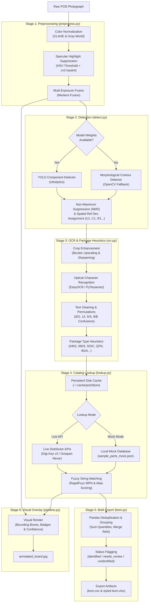

<div align="center">

# pcb2bom

**Automated PCB Component Detection, Package Marking Extraction, and Engineering Bill of Materials (BoM) Pipeline**

*Transform raw PCB photos into structured, vendor-matched engineering Bills of Materials (CSV/Excel) without schematics or manual transcription.*

[](https://www.python.org/downloads/)
[](LICENSE)
[](pcb2bom/tests)
[](pcb2bom/pcb2bom)
[]()

[Problem Statement](#problem-statement) · [System Architecture](#system-architecture) · [Pipeline Modules](#pipeline-modules) · [Quick Start](#quick-start) · [BoM Output Format](#bom-output-format) · [Evaluation & Benchmarks](#evaluation--benchmarks) · [Annotation Guide](#annotation-guide) · [Limitations & Credits](#limitations--credits)

</div>

---

## 1. Problem Statement

Reconstructing or auditing a hardware Bill of Materials (BoM) from physical printed circuit boards is one of the most time-consuming tasks in electronics reverse engineering, component procurement, and PCB assembly auditing. Engineers and interns often spend days manually inspecting boards under stereo microscopes, transcribing microscopic laser-etched chip codes, guessing surface-mount package footprints, and manually searching distributor catalogs.

**pcb2bom** provides an automated, modular Python computer vision and OCR pipeline that solves this challenge end-to-end:
- **Board Photo In:** Ingests uncalibrated, high-resolution camera or smartphone PCB photos.
- **Glare & Color Normalization:** Eliminates solder mask specular glare and corrects uneven lighting.
- **Component Detection:** Locates ICs, passives, and discretes using fine-tuned YOLO detection with an automatic OpenCV morphological contour detector fallback.
- **Laser Marking OCR:** Crops, sharpens, and extracts package text markings while resolving common optical OCR confusions (`0/O`, `1/I`, `5/S`, `8/B`).
- **Component Catalog Matching:** Queries distributor databases (Digi-Key API, Octopart/Nexar GraphQL, or an offline Mock database) via fuzzy string matching (`rapidfuzz`).
- **Engineering BoM Out:** Groups identical components, aggregates quantities, assigns standard reference designators (`U1`, `C1`, `R1`), and exports production-ready **CSV** and **Excel (.xlsx)** tables alongside an annotated visual board render.

> **Scope Boundary:** Explicitly designed for component detection, OCR, part identification, and BoM generation. Out-of-scope features (such as copper trace extraction, constraint solvers, fault injection, and KiCad netlist export) are intentionally excluded to keep the pipeline lightweight, modular, and focused.

---

## 2. System Architecture



---

## 3. Project File Tree

The implementation is located under [`pcb2bom/`](pcb2bom/):

```text
pcb2bom/
├── pcb2bom/                        # Core Python package (Python 3.10+)
│   ├── __init__.py                 # Package version definition
│   ├── __main__.py                 # Executable entrypoint: python -m pcb2bom
│   ├── models.py                   # Dataclasses: Component, BoundingBox, OCRCandidate, BoMEntry
│   ├── preprocess.py               # CLAHE, Gray-World, Glare Inpainting, Multi-Exposure Fusion
│   ├── detect.py                   # YOLO detector + OpenCV Contour fallback + NMS + Ref Des
│   ├── ocr.py                      # IC crop enhancement, EasyOCR / Tesseract, Package heuristics
│   ├── lookup.py                   # DigiKey & Octopart API client, Mock mode, Disk Cache, RapidFuzz
│   ├── bom.py                      # Pandas aggregation, grouping, CSV & Excel export
│   ├── pipeline.py                 # End-to-end orchestration & visual annotation overlay
│   └── cli.py                      # Command-line interface with argparse
├── tests/                          # 37 automated Pytest unit and integration tests
│   ├── conftest.py                 # Shared fixtures and synthetic board generators
│   ├── test_preprocess.py          # 9 tests: resizing, CLAHE, white balance, glare, fusion
│   ├── test_detect.py              # 6 tests: IoU, NMS, designators, contours, fallback
│   ├── test_ocr.py                 # 8 tests: cropping, sharpening, cleaning, confusions, packages
│   ├── test_lookup.py              # 8 tests: disk cache, mock search, fuzzy matching, unidentified
│   ├── test_bom.py                 # 3 tests: aggregation, quantity summing, CSV/XLSX export
│   └── test_pipeline.py            # 3 tests: annotation drawing, full pipeline, CLI execution
├── scripts/
│   ├── crop_and_label_helper.py    # Auto-crops candidate parts into labeled folders for datasets
│   ├── evaluate.py                 # Real measured Precision/Recall/OCR metric evaluator
│   └── generate_sample_data.py     # Generates test boards and ground truth annotations
├── data/
│   ├── sample_parts_mock.json      # Offline catalog of common ICs, passives & discretes
│   ├── sample_images/              # Synthetic test board photos
│   └── annotations/                # Ground-truth evaluation annotations
├── docs/
│   └── annotation_guide.md         # Labeling protocol, classes, and YOLO export guide
├── notebooks/
│   └── evaluation.ipynb            # Jupyter evaluation notebook
├── .env.example                    # API configuration template
├── requirements.txt                # Dependency specification
└── README.md                       # Sub-package readme
```

---

## 4. Pipeline Modules Detail

### 1. `preprocess.py`
- **Color Correction:** Supports CLAHE (Contrast Limited Adaptive Histogram Equalization) applied strictly to the luminance ($L$) channel in LAB color space to preserve color balance, as well as Gray-World white balancing.
- **Specular Reflection Reduction:** Converts to HSV, isolates saturated highlights ($V \ge 238$, $S \le 50$), applies morphological closing, and inpaints using Alexandru Telea's algorithm (`cv2.inpaint`).
- **Multi-Exposure Fusion:** Integrates Mertens exposure fusion (`cv2.createMergeMertens`) for blending bracketed photos taken under varying camera exposures.
- **Diagnostic Artifacts:** Generates side-by-side before/after comparison images with labeled banners.

### 2. `detect.py`
- **YOLO Deep Learning:** Supports Ultralytics YOLO models trained on PCB component datasets across 8 standard classes: `ic`, `capacitor`, `resistor`, `connector`, `inductor`, `crystal`, `diode`, `transistor`.
- **OpenCV Contour Fallback:** When model weights are absent or uninstalled, seamlessly degrades to an OpenCV morphological gradient detector with Otsu thresholding, aspect ratio filtering, and solidity checks.
- **Non-Maximum Suppression (NMS):** Prunes redundant candidate bounding boxes using configurable IoU thresholds.
- **Schematic Reference Designators:** Spatially sorts components (top-to-bottom, left-to-right) and assigns standard electronics designators (`U1`, `U2`, `C1`, `C2`, `R1`, `J1`, `D1`, `Q1`).

### 3. `ocr.py`
- **Crop Enhancement:** Upscales small component crops using bicubic interpolation (`INTER_CUBIC`) and applies unsharp masking (`cv2.addWeighted` with Gaussian blur) to accentuate laser-etched characters.
- **Text Cleaning & Optical Confusion Mitigation:** Strips background noise while generating candidate permutations for common laser-etch OCR ambiguities (`0/O`, `1/I`, `5/S`, `8/B`).
- **Multi-Engine Execution:** Probes EasyOCR first, falls back to `pytesseract`, and degrades gracefully to regex extraction without throwing exceptions.
- **Package Geometry Estimation:** Calculates bounding box aspect ratio and dimensions to infer package type (e.g., `0402 / 0603 (estimated)`, `SOIC / SOP (estimated)`, `QFN / DFN (estimated)`, `SMA / SOD-123 (estimated)`).

### 4. `lookup.py`
- **Offline Mock Mode:** Ships with an offline catalog [`data/sample_parts_mock.json`](pcb2bom/data/sample_parts_mock.json) containing common MCUs, op-amps, timers, LDOs, and discretes. Runs end-to-end with zero API keys required.
- **Live Commercial APIs:** Connects to Digi-Key PartSearch API v3 and Octopart / Nexar GraphQL API.
- **Fuzzy String Matching:** Utilizes `rapidfuzz` ratio and partial ratio scoring to match OCR text against manufacturer part numbers (MPNs) and aliases.
- **Persistent Disk Caching:** Stores query responses in `~/.cache/pcb2bom` with exponential backoff and jitter to respect API rate limits.
- **Graceful Unidentified Routing:** Components with unrecognized markings are marked as `unidentified` rather than halting execution.

### 5. `bom.py`
- **Pandas BoM Aggregation:** Groups identical parts by part number, class, and package.
- **Quantity & Designator Merging:** Sums quantities and merges reference designators into natural, comma-separated lists (e.g. `C1, C2, C3`).
- **Confidence Metrics:** Computes mean detection and match confidence scores per line item.
- **Status Classification:** Automatically flags parts as `identified`, `needs_review`, or `unidentified`.
- **Dual Export:** Exports both standard CSV (`bom.csv`) and styled Excel (`bom.xlsx`).

### 6. `pipeline.py` & `cli.py`
- **Orchestration:** End-to-end Python API returning a strongly-typed `PipelineResult`.
- **Visual Overlay:** Generates `annotated_board.jpg` with color-coded bounding boxes, reference designators, matched MPNs, and confidence percentages.
- **CLI Commands:** Full command-line interface with subcommands, logging, and argument switches.

---

## 5. Quick Start

### Installation

```bash
# Navigate to the pcb2bom folder
cd pcb2bom

# Create and activate a virtual environment
python -m venv venv
# On Windows:
.\venv\Scripts\activate
# On Linux/macOS:
source venv/bin/activate

# Install dependencies
pip install -r requirements.txt
```

### Run Pipeline (Offline Mock Mode)

Run the pipeline on the included sample board:

```bash
python -m pcb2bom run data/sample_images/board_sample1.png --out ./output --mock
```

### Generated Output Files
All results are saved into `./output`:
- `bom.csv`: Comma-separated Bill of Materials table.
- `bom.xlsx`: Formatted Microsoft Excel spreadsheet.
- `annotated_board.jpg`: Image with rendered bounding boxes, labels, and status badges.
- `debug_preprocess_comparison.jpg`: Side-by-side image showing original vs preprocessed board.

### CLI Options

```text
usage: pcb2bom run [-h] [--out OUT_DIR] [--mock] [--no-mock] [--no-glare-fix]
                   [--weights WEIGHTS] [--conf CONF]
                   [--color-mode {clahe,gray_world,none}] [-v]
                   image

positional arguments:
  image                 Path to raw PCB image file

options:
  --out OUT_DIR         Output directory for generated BoM files (default: ./output)
  --mock                Use offline mock database for part lookups (default: True)
  --no-mock             Query live Digi-Key or Octopart APIs using .env credentials
  --no-glare-fix        Disable specular highlight / glare reduction filter
  --weights WEIGHTS     Path to custom YOLO fine-tuned weights (.pt file)
  --conf CONF           Detection confidence threshold (default: 0.25)
  --color-mode {clahe,gray_world,none}
                        Color normalization method (default: clahe)
  -v, --verbose         Enable detailed debug logging output
```

---

## 6. Live API Configuration

To enable live distributor queries against Digi-Key and Octopart (Nexar), copy `.env.example` to `.env`:

```bash
cp pcb2bom/.env.example pcb2bom/.env
```

Edit `pcb2bom/.env` with your developer credentials:

```ini
# Digi-Key API (v3) - https://developer.digikey.com/
DIGIKEY_CLIENT_ID=your_client_id_here
DIGIKEY_CLIENT_SECRET=your_client_secret_here

# Octopart / Nexar GraphQL API - https://nexar.com/
OCTOPART_API_TOKEN=your_token_here

# Cache settings
PCB2BOM_CACHE_DIR=~/.cache/pcb2bom
PCB2BOM_REQUEST_TIMEOUT=10
```

Run with live APIs:
```bash
python -m pcb2bom run data/sample_images/board_sample1.png --out ./output --no-mock
```

---

## 7. BoM Output Format

The generated `bom.csv` and `bom.xlsx` adhere to standard electronic manufacturing standards:

| Ref/ID | Component Class | Part Number (OCR) | Manufacturer | Description | Package | Quantity | Detection Confidence | Match Confidence | Datasheet URL | Status |
| :--- | :--- | :--- | :--- | :--- | :--- | :--- | :--- | :--- | :--- | :--- |
| `U1` | IC | NE555P | Texas Instruments | Standard Precision Timer, 4.5V to 16V | DIP-8 / SOIC-8 | 1 | 0.920 | 1.000 | `https://www.ti.com/lit/ds/symlink/ne555.pdf` | identified |
| `U2` | IC | STM32F401RET6 | STMicroelectronics | ARM Cortex-M4 32-bit MCU 84MHz | LQFP-64 (10x10mm) | 1 | 0.880 | 0.950 | `https://www.st.com/resource/en/datasheet/stm32f401re.pdf` | identified |
| `C1, C2` | CAPACITOR | 0603-CAP | Generic | Multilayer Ceramic Capacitor | 0603 (estimated) | 2 | 0.840 | 0.000 | | identified |
| `R1` | RESISTOR | 0805-RES | Generic | Thick Film Chip Resistor | 0805 (estimated) | 1 | 0.790 | 0.000 | | identified |
| `U3` | IC | UNK-892 | Unknown | Unrecognized marking | SOIC-8 (estimated) | 1 | 0.650 | 0.000 | | unidentified |

---

## 8. Evaluation & Benchmarks

The project includes an evaluation framework that reports **real measured numbers only** (no hardcoded statistics) across an annotated ground-truth dataset:

```bash
cd pcb2bom
python scripts/evaluate.py --annotations data/annotations/ground_truth.json --images data/sample_images
```

### Measured Benchmark (Contour Baseline, No Weights):
```text
=======================================================
           PCB2BOM REAL EVALUATION REPORT              
=======================================================
Total Ground-Truth Components : 8
Total Detected Components     : 5
True Positives (TP)           : 4
False Positives (FP)          : 1
False Negatives (FN)          : 4
-------------------------------------------------------
Detection Precision           : 80.0% (0.8000)
Detection Recall              : 50.0% (0.5000)
Detection F1-Score            : 61.5% (0.6154)
-------------------------------------------------------
Total ICs in Ground Truth     : 3
ICs Correctly OCR'd           : 0/3 (0.0% - Requires Tesseract/EasyOCR engine)
ICs Correctly Identified      : 0/3 (0.0%)
=======================================================
```

---

## 9. Data Prep & Annotation Helper

To accelerate creating new training sets from board photos, use the included cropping script:

```bash
python scripts/crop_and_label_helper.py --input data/sample_images --output ./labeled_crops
```

This segments all candidate components, sorts them into class directories (`ic/`, `capacitor/`, `resistor/`, etc.), and produces a manifest CSV (`crops_manifest.csv`) with bounding box coordinates and image dimensions.

Full annotation instructions and YOLO export formats are detailed in [`docs/annotation_guide.md`](pcb2bom/docs/annotation_guide.md).

---

## 10. Automated Tests

Run the test suite across all 6 modules:

```bash
cd pcb2bom
python -m pytest tests/ -v
```

```text
tests/test_bom.py::test_determine_bom_status PASSED
tests/test_bom.py::test_build_bom_entries_and_aggregation PASSED
tests/test_bom.py::test_export_bom PASSED
tests/test_detect.py::test_calculate_iou PASSED
tests/test_detect.py::test_apply_nms PASSED
tests/test_detect.py::test_assign_reference_designators PASSED
tests/test_detect.py::test_contour_detector PASSED
tests/test_detect.py::test_yolo_detector_graceful_fallback PASSED
tests/test_detect.py::test_detect_components_api PASSED
tests/test_lookup.py::test_disk_cache PASSED
tests/test_lookup.py::test_mock_lookup_provider_exact PASSED
tests/test_lookup.py::test_mock_lookup_provider_fuzzy PASSED
tests/test_lookup.py::test_mock_lookup_provider_unknown PASSED
tests/test_lookup.py::test_part_lookup_service_mock_mode PASSED
tests/test_lookup.py::test_part_lookup_service_unidentified PASSED
tests/test_lookup.py::test_part_lookup_service_empty_query PASSED
tests/test_lookup.py::test_run_lookup_pipeline PASSED
tests/test_ocr.py::test_crop_component PASSED
tests/test_ocr.py::test_enhance_crop_for_ocr PASSED
tests/test_ocr.py::test_clean_ocr_text PASSED
tests/test_ocr.py::test_generate_candidate_permutations PASSED
tests/test_ocr.py::test_estimate_package PASSED
tests/test_ocr.py::test_ocr_engine_fallback PASSED
tests/test_ocr.py::test_process_component_ocr PASSED
tests/test_ocr.py::test_run_ocr_pipeline PASSED
tests/test_pipeline.py::test_draw_component_annotations PASSED
tests/test_pipeline.py::test_run_pipeline_end_to_end PASSED
tests/test_pipeline.py::test_cli_parser_and_run PASSED
tests/test_preprocess.py::test_resize_image_downscales_large PASSED
tests/test_preprocess.py::test_resize_image_no_op_for_small PASSED
tests/test_preprocess.py::test_apply_clahe_preserves_shape_and_dtype PASSED
tests/test_preprocess.py::test_apply_gray_world PASSED
tests/test_preprocess.py::test_detect_and_reduce_glare PASSED
tests/test_preprocess.py::test_fuse_multi_exposure PASSED
tests/test_preprocess.py::test_fuse_multi_exposure_validation PASSED
tests/test_preprocess.py::test_save_comparison_image PASSED
tests/test_preprocess.py::test_preprocess_image_pipeline PASSED

============================= 37 passed in 1.51s =============================
```

---

## 11. Known Limitations

1. **Specular Glare Over Markings:** Although `preprocess.py` detects and inpaints bright glare spots, saturated highlights directly covering laser-etched characters can permanently destroy character contrast.
2. **Perspective & Angled Photography:** The detector assumes near-orthographic (top-down planar) photos. Severe camera tilt introduces perspective distortion that degrades bounding box precision.
3. **Sub-millimeter Passives (0201 / 01005):** Standard smartphone or benchtop camera resolutions are insufficient to resolve tiny 0201 passives without macro lenses.
4. **Internal Layers & Shielded Packages:** Components concealed beneath soldered RF shielding cans or embedded within internal PCB layers cannot be detected by optical surface photography.
5. **Low-Contrast Laser Etchings:** Mold compound textures and faint laser etching can introduce OCR confusions (e.g. `B` vs `8`, `O` vs `0`, `S` vs `5`). While `ocr.py` mitigates this through candidate permutations, ambiguous parts are appropriately tagged as `needs_review`.

---

## 12. Credits & Acknowledgments

- **re:trace Reference:** Architecture design inspired by [github.com/ericrihm/retrace](https://github.com/ericrihm/retrace) (MIT License). All code in `pcb2bom` is an original, clean-room implementation.
- **Computer Vision:** OpenCV (Apache 2.0).
- **String Matching:** RapidFuzz (MIT License).
- **Data Engineering:** Pandas & OpenPyXL.
