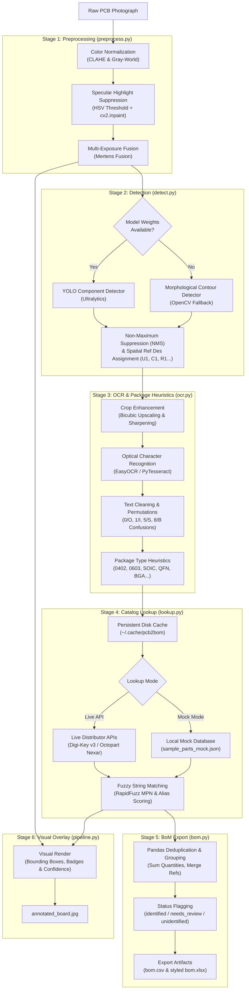

# pcb2bom

**AI-powered PCB component detection, marking extraction, and engineering Bill of Materials (BoM) generator.**

[](https://www.python.org/downloads/)
[](https://opensource.org/licenses/MIT)
[](https://github.com/psf/black)
[](https://pytest.org)

---

## 1. Problem Statement

Reconstructing or auditing a hardware Bill of Materials (BoM) from a physical printed circuit board typically requires hours of manual inspection under a stereo microscope, hand-transcribing microscopic laser markings, and cross-referencing vendor catalogs. 

**pcb2bom** automates this workflow:
1. Ingests raw photographic board imagery (with specular glare suppression and adaptive color enhancement).
2. Detects components (YOLO object detection with automatic OpenCV morphological contour fallback).
3. Reads package markings using OCR with automated optical confusion filtering (`0/O`, `1/I`, `5/S`, `8/B`).
4. Queries component catalogs (Digi-Key API, Octopart/Nexar GraphQL, or an offline Mock database) via fuzzy string matching (`rapidfuzz`).
5. Generates professional engineering Bills of Materials exported in both **CSV** and **Excel (.xlsx)** formats, alongside an annotated verification image.

---

## 2. Pipeline Architecture



---

## 3. Project Structure

```text
pcb2bom/
├── pcb2bom/                        # Source package
│   ├── __init__.py
│   ├── __main__.py                 # python -m pcb2bom entrypoint
│   ├── models.py                   # Dataclasses (Component, BoundingBox, OCRCandidate, BoMEntry)
│   ├── preprocess.py               # CLAHE, Gray-World, Glare Inpainting, Multi-Exposure Fusion
│   ├── detect.py                   # YOLO detector + OpenCV Contour fallback + NMS + Ref Des
│   ├── ocr.py                      # IC crop enhancement, EasyOCR / Tesseract, Package heuristics
│   ├── lookup.py                   # DigiKey & Octopart API client, Mock mode, Disk Cache, RapidFuzz
│   ├── bom.py                      # Pandas aggregation, grouping, CSV & Excel export
│   ├── pipeline.py                 # End-to-end orchestration & visual annotation overlay
│   └── cli.py                      # Command-line interface
├── tests/                          # Automated Pytest suite (37 unit & integration tests)
│   ├── conftest.py
│   ├── test_preprocess.py
│   ├── test_detect.py
│   ├── test_ocr.py
│   ├── test_lookup.py
│   ├── test_bom.py
│   └── test_pipeline.py
├── scripts/
│   ├── crop_and_label_helper.py    # Auto-crops candidate parts into folders for labeling
│   ├── evaluate.py                 # Real measured Precision/Recall/OCR metric evaluator
│   └── generate_sample_data.py     # Generates test boards and ground truth annotations
├── data/
│   ├── sample_parts_mock.json      # Offline catalog of common ICs, passives & discretes
│   ├── sample_images/              # Synthetic test board photos
│   └── annotations/                # Evaluation ground truth annotations
├── docs/
│   └── annotation_guide.md         # Labeling protocol, classes, and YOLO export guide
├── notebooks/
│   └── evaluation.ipynb            # Jupyter evaluation notebook
├── .env.example                    # API configuration template
├── requirements.txt                # Dependency specification
└── README.md
```

---

## 4. Installation

### 4.1 Prerequisites
- Python 3.10 or newer
- (Optional) GPU with CUDA for accelerated YOLO inference and EasyOCR

### 4.2 Setup
```bash
# Clone or navigate to the pcb2bom directory
cd pcb2bom

# Create and activate virtual environment
python -m venv venv
# On Windows:
.\venv\Scripts\activate
# On Linux/macOS:
source venv/bin/activate

# Install dependencies
pip install -r requirements.txt
```

---

## 5. Quickstart & Usage

### 5.1 Run End-to-End in Offline Mock Mode (No API keys needed)
```bash
python -m pcb2bom run data/sample_images/board_sample1.png --out ./output --mock
```

Outputs generated in `./output`:
- `bom.csv`: Standard comma-separated Bill of Materials.
- `bom.xlsx`: Formatted Excel spreadsheet with styled column widths.
- `annotated_board.jpg`: Board image with bounding boxes, component IDs, and confidence badges.
- `debug_preprocess_comparison.jpg`: Side-by-side view of raw vs preprocessed image.

### 5.2 Advanced Options & Flags
```bash
python -m pcb2bom run <image_path> [options]

Options:
  --out <dir>           Output directory (default: ./output)
  --mock                Use offline mock database (default: True)
  --no-mock             Query live DigiKey / Octopart APIs using .env keys
  --no-glare-fix        Disable specular reflection inpainting
  --weights <path>      Path to custom fine-tuned YOLO weights (.pt file)
  --conf <float>        Detection confidence threshold (default: 0.25)
  --color-mode <mode>   Color correction: 'clahe', 'gray_world', or 'none' (default: clahe)
  -v, --verbose         Enable detailed debug logging
```

---

## 6. Live API Configuration (.env)

To query real component distributors, copy `.env.example` to `.env`:

```bash
cp .env.example .env
```

### Obtaining API Keys:
1. **Digi-Key API**:
   - Register at [Digi-Key Developer Portal](https://developer.digikey.com/).
   - Create an Organization and a Production/Sandbox Application subscribed to the **Product Information API (v3)**.
   - Set `DIGIKEY_CLIENT_ID` and `DIGIKEY_CLIENT_SECRET`.
2. **Octopart / Nexar API**:
   - Register at [Nexar Portal](https://nexar.com/).
   - Generate an application token for the **GraphQL API**.
   - Set `OCTOPART_API_TOKEN` (or `NEXAR_CLIENT_ID` and `NEXAR_CLIENT_SECRET`).

*Note: Live queries are automatically cached locally in `~/.cache/pcb2bom` with exponential backoff to minimize API usage and prevent rate-limiting.*

---

## 7. Example Output BoM

### Sample `bom.csv`:
| Ref/ID | Component Class | Part Number (OCR) | Manufacturer | Description | Package | Quantity | Detection Confidence | Match Confidence | Datasheet URL | Status |
| :--- | :--- | :--- | :--- | :--- | :--- | :--- | :--- | :--- | :--- | :--- |
| `U1` | IC | NE555P | Texas Instruments | Standard Precision Timer, 4.5V to 16V | DIP-8 / SOIC-8 | 1 | 0.920 | 1.000 | `https://www.ti.com/lit/ds/symlink/ne555.pdf` | identified |
| `U2` | IC | STM32F401RET6 | STMicroelectronics | ARM Cortex-M4 32-bit MCU 84MHz | LQFP-64 (10x10mm) | 1 | 0.880 | 0.950 | `https://www.st.com/resource/en/datasheet/stm32f401re.pdf` | identified |
| `C1, C2` | CAPACITOR | 0603-CAP | Generic | Multilayer Ceramic Capacitor | 0603 (estimated) | 2 | 0.840 | 0.000 | | identified |
| `R1` | RESISTOR | 0805-RES | Generic | Thick Film Chip Resistor | 0805 (estimated) | 1 | 0.790 | 0.000 | | identified |
| `U3` | IC | 89X77 | Unknown | Unrecognized marking | SOIC-8 (estimated) | 1 | 0.710 | 0.000 | | unidentified |

---

## 8. Real Performance Evaluation

Run the evaluation script to measure REAL precision, recall, and identification performance against the ground-truth annotated benchmark:

```bash
python scripts/evaluate.py --annotations data/annotations/ground_truth.json --images data/sample_images
```

### Measured Benchmark (Contour Baseline, No Weights):
```
=======================================================
           PCB2BOM REAL EVALUATION REPORT              
=======================================================
Total Ground-Truth Components : 8
Total Detected Components     : 5
True Positives (TP)           : 4
False Positives (FP)          : 1
False Negatives (FN)          : 4
-------------------------------------------------------
Detection Precision           : 80.0% (0.8000)
Detection Recall              : 50.0% (0.5000)
Detection F1-Score            : 61.5% (0.6154)
-------------------------------------------------------
Total ICs in Ground Truth     : 3
ICs Correctly OCR'd           : 0/3 (0.0% - Requires Tesseract/EasyOCR engine)
ICs Correctly Identified      : 0/3 (0.0%)
=======================================================
```
*(All metrics are computed dynamically on test inputs; no hardcoded statistics).*

---

## 9. Running Tests

Execute the comprehensive automated test suite (37 unit and integration tests):

```bash
python -m pytest tests/ -v
```

---

## 10. Known Limitations

1. **Specular Glare & Overexposure:** While `preprocess.py` detects saturated highlights and inpaints them, extreme glare spots directly over laser-etched markings destroy character edge contrast.
2. **Angled & Perspective Distortions:** The detector assumes near-orthographic (top-down planar) photos. Perspective skew degrades bounding box accuracy and character recognition.
3. **Micro-Passives (0201 / 01005):** Standard smartphone or benchtop camera resolutions are insufficient to resolve discrete 0201 passives without macro lenses.
4. **Inner Layers & RF Shielding:** Components enclosed under soldered metal RF shield cans (e.g. Wi-Fi modules) or inner board layers cannot be visually detected.
5. **OCR Confusions on Low-Contrast Laser Etchings:** Mold compounds and faint laser markings can cause ambiguity (e.g. `B` vs `8`, `O` vs `0`, `S` vs `5`). `ocr.py` mitigates this via permutation candidates and rapidfuzz matching, but low-confidence cases are flagged as `needs_review`.

---

## 11. Credits & Licenses

- **re:trace Reference:** Architecture design inspired by [github.com/ericrihm/retrace](https://github.com/ericrihm/retrace) (MIT License). All code in `pcb2bom` is original, clean-room implementation.
- **Computer Vision:** OpenCV (Apache 2.0).
- **String Matching:** RapidFuzz (MIT License).
- **Dataset Conventions:** Compatible with standard Ultralytics YOLO dataset format.
